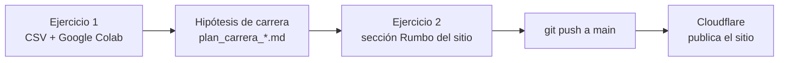
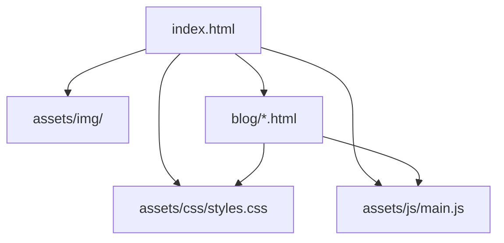

# TALLERDDD · Data Driven Day 2026

**Tu carrera a prueba de futuro con IA · Tecnológico de Monterrey, Campus Sonora Norte · 11 de noviembre de 2026**

Dos ejercicios que forman un solo proyecto: **investigar oportunidades profesionales con datos** (Ejercicio 1) y **convertir esa hipótesis en un sitio profesional propio** (Ejercicio 2). El sitio de ejemplo es de Mateo Duarte, un personaje de demostración que cada estudiante sustituye por su propia información.



## Estructura del repositorio

La raíz **es** el sitio web. El Ejercicio 1 vive aparte y nunca se publica.

```text
TALLERDDD/
├── index.html          # Portada: presentación, proyectos, blog, CV y contacto
├── blog/               # Artículos (una página HTML por artículo)
├── assets/
│   ├── css/styles.css  # Todo el diseño
│   ├── js/main.js      # Menú en celular, imprimir CV y año
│   └── img/            # Fotos WebP y favicon
├── robots.txt          # SEO: permisos para buscadores + ubicación del sitemap
├── sitemap.xml         # SEO: lista de páginas del sitio
├── _headers            # Cabeceras de seguridad para Cloudflare
├── .assetsignore       # Lo que Cloudflare NO publica (ejercicio_1/, README, etc.)
├── ejercicio_1/        # Análisis de carrera en Colab (no se publica)
├── README.md
└── AGENTS.md           # Reglas para agentes de IA
```

## Cómo obtener el proyecto

```bash
git clone https://github.com/badouintec/tallerDDD.git
cd tallerDDD
code .
```

Para publicar tu propio sitio necesitas tu copia: en GitHub usa **Fork** (o **Use this template**) y clona tu versión.

## Requisitos

- **VS Code**, **Git**, navegador y acceso a Google Colab.
- Cuenta en **GitHub** o **GitLab** y cuenta gratuita de **Cloudflare**.
- El sitio es HTML, CSS y JavaScript puro: no hace falta instalar nada ni compilar.
- Opcional: un agente de programación en VS Code para practicar con `AGENTS.md`.

## Ejercicio 1 — Analítica de carrera con CSV y Colab

Caso **Mecatrónica**, egreso 2027, Hermosillo. En Colab se cruzan demografía CONAPO/COESPO, INEGI, ingreso nacional OLA, comparación BLS EE. UU., una muestra de vacantes de Hermosillo, mapas y un **agrupamiento K-Means + PCA** de requisitos de ofertas.

1. Abre `ejercicio_1/README.md`.
2. Importa `ejercicio_1/Career_Intelligence_Sonora_2026.ipynb` a [Google Colab](https://colab.research.google.com/) y sube `CSV_Career_Intelligence_Sonora_2026.zip` cuando lo pida (contiene los 15 CSV de `ejercicio_1/datos/`).
3. Llena la sección **"Mi decisión"** del plan que descarga el notebook: hipótesis, evidencia, un dato que la limita y una acción para los próximos 30 días. Esos cuatro campos van después a la sección **Rumbo** de tu sitio.

**Importante:** LQ manufacturero no equivale a Índice de Complejidad Económica. Ni BLS ni la muestra de 13 vacantes permiten predecir el sueldo de un mecatrónico en Sonora.

## Ejercicio 2 — Tu sitio profesional

### 1. Define tu identidad

Antes de tocar código, responde:

1. ¿Cómo quiero que me describan profesionalmente?
2. ¿Qué industria o problema me interesa en 2 a 5 años?
3. ¿Qué proyectos puedo demostrar con evidencia real?
4. ¿Qué información quiero que sea pública y cuál no?
5. ¿Cuál es la única acción que quiero que haga un visitante?
6. ¿Qué tono, imágenes y colores representan mi disciplina?

### 2. Cómo está hecho el sitio



| Archivo | Qué contiene | Qué cambiar |
| --- | --- | --- |
| `index.html` | Secciones comentadas: Portada, Sobre mí, Rumbo, Proyectos, Blog, CV y Contacto | Textos, `<title>`, `description` y datos estructurados (JSON-LD) |
| `assets/css/styles.css` | 13 secciones numeradas. La **1** contiene todos los colores y fuentes, con modo oscuro automático | Cambia solo la sección 1 para tener tu propia paleta |
| `assets/js/main.js` | Menú en celular, botón de imprimir CV y año del pie | Normalmente nada |
| `assets/img/` | Cada foto en 3 tamaños; el navegador descarga solo el que necesita (`srcset`) | Tus fotos en WebP con los mismos anchos |
| `blog/*.html` | Un artículo por archivo; sus rutas usan `../` porque viven en una subcarpeta | Copia uno, cámbialo y agrégalo al Blog de `index.html` y a `sitemap.xml` |

### 3. Reemplaza a Mateo por ti

Busca `Mateo` en todo el proyecto (**Ctrl+Shift+F** o **Cmd+Shift+F** en VS Code) y ve en este orden:

| Qué | Dónde |
| --- | --- |
| Nombre, `<title>`, `description` y JSON-LD | `<head>` de `index.html` |
| Frase principal, foto y datos rápidos | Portada en `index.html` |
| Hipótesis, evidencia, límite y acción | Sección **Rumbo**: copia los cuatro campos de tu plan del Ejercicio 1 |
| Proyectos y artículos | Secciones Proyectos y Blog; archivos de `blog/` |
| CV y correo | Sección CV y pie de página; busca también `example.com` |
| Iniciales del logotipo | `brand-mark` (dice `MD`) en las 3 páginas y `assets/img/favicon.svg` |
| Colores | Sección 1 de `assets/css/styles.css` |

**Fotos:** conviértelas a WebP en [squoosh.app](https://squoosh.app) (no requiere instalar nada) con los anchos que ya existen en `assets/img/` (por ejemplo 440, 900 y 1300 px) y actualiza los nombres en el ``. Si solo haces un tamaño, borra el atributo `srcset`.

Si un dato no lo puedes demostrar, quítalo. Una sección corta y verdadera vale más que una larga e inventada.

### 4. Prueba

Abre `index.html` con doble clic en tu navegador. No hay que compilar nada: lo que ves es lo que se publica.

Revisa después de cada cambio:

- **Celular:** el botón "Menú ☰" abre y cierra el menú.
- **Impresión:** "Imprimir / Guardar PDF" muestra solo el CV.
- **Teclado:** al presionar Tab aparece "Saltar al contenido".
- **Modo oscuro:** cambia el tema del sistema y verifica que todo se lea bien.

### 5. Prompts para trabajar con el agente

- **Personalizar:** «Lee `AGENTS.md`. Cambia el sitio a mi carrera y aspiraciones sin inventar experiencia, logros ni enlaces. Primero dame un plan de archivos; luego haz el cambio mínimo».
- **Diseño:** «Analiza `index.html` y la sección 1 de `styles.css`. Propón una paleta y jerarquía acordes con mi disciplina, sin dependencias. Explica cómo verificar cada cambio».
- **SEO:** «Audita títulos, descripciones, encabezados, Open Graph, `alt`, JSON-LD, `robots.txt` y `sitemap.xml`. Separa lo que se verifica en local de lo que requiere dominio».
- **Conectar ejercicios:** «Lee mi `plan_carrera_*.md` del Ejercicio 1 y actualiza la sección Rumbo de `index.html` con mi hipótesis, evidencia, límite y acción. Usa solo cifras que estén en el plan y no prometas empleo».

## SEO

| Pieza | Dónde | Para qué |
| --- | --- | --- |
| `<title>` y `description` | Cada página HTML | Lo que aparece en Google |
| Open Graph | Cada página HTML | Vista previa en WhatsApp, LinkedIn, etc. |
| JSON-LD `Person` | `index.html` | Le dice a Google quién eres |
| `canonical` | Cada página HTML | La URL oficial de cada página |
| `robots.txt` | Raíz | Permite rastrear y apunta al sitemap |
| `sitemap.xml` | Raíz | Lista de páginas del sitio |

Los archivos usan el dominio de ejemplo `https://example.com`. Cuando tengas tu URL real, cámbiala en todo el proyecto con **Buscar y reemplazar** de VS Code (**Ctrl+Shift+H** o **Cmd+Shift+H**).

**`noindex` está activo** en las tres páginas para que el ejemplo no aparezca en Google. Cuando el sitio tenga **solo tu información real** y tu dominio, borra la línea `<meta name="robots" content="noindex,nofollow">` de cada página.

## Publicar en Cloudflare

Cloudflare Dashboard → **Workers & Pages** → **Create** → **Import a repository** → elige tu repo:

| Ajuste | Valor |
| --- | --- |
| Project name | `tu-nombre` |
| Build command | *(vacío)* |
| Deploy command | `npx wrangler deploy --assets . --name tu-nombre --compatibility-date 2026-11-11` |
| Preview command | `npx wrangler versions upload --assets . --name tu-nombre --compatibility-date 2026-11-11` |

Usa el mismo nombre en **Project name** y en `--name`. Cada `git push` a `main` publica el sitio en `tu-nombre.<subdominio>.workers.dev`.

Se publica la raíz tal cual, **excepto** lo que aparece en `.assetsignore`: `ejercicio_1/`, `README.md`, `AGENTS.md` y archivos ocultos. Si agregas carpetas privadas, añádelas ahí.

**No dejes el deploy command por defecto** (`npx wrangler deploy` a secas): Cloudflare intentaría detectar el proyecto por su cuenta y crearía una rama con un pull request.

## Herramientas del taller

| Herramienta | Para qué |
| --- | --- |
| **HTML/CSS/JS sin frameworks** | Sitio ligero que cualquier navegador abre tal cual |
| **`AGENTS.md`** | Reglas para agentes de IA; pídele al agente que lo lea si no lo hace solo |
| **[Ponytail](https://ponytail.dev/)** | Principios de simplicidad y cambios mínimos (integrados en `AGENTS.md`) |
| **[Graphify](https://marketplace.visualstudio.com/items?itemName=anytechiestudio.graphify-vscode)** | Ver relaciones entre archivos (`Graphify: Build Knowledge Graph`) |
| **[Markdown Preview Enhanced](https://marketplace.visualstudio.com/items?itemName=shd101wyy.markdown-preview-enhanced)** | Leer este README con los diagramas renderizados |
| **[Context7 MCP](https://github.com/upstash/context7-vscode-extension)** | Documentación actualizada para el agente |
| **[Cloudflare Workers](https://developers.cloudflare.com/workers/static-assets/)** | Hospedaje gratuito del sitio estático, con despliegue desde Git |

## Al terminar el taller te llevas

1. Una hipótesis de carrera basada en datos, con sus límites claros.
2. Tu propio sitio profesional, con CV imprimible, listo para seguir mejorándolo.
3. Un flujo de trabajo con IA: pedir un plan, revisar lo que propone y verificar antes de publicar.
4. Opcional: tu sitio publicado en Cloudflare, cuando tu contenido sea real.

## Referencias

- Cloudflare Workers, static assets: <https://developers.cloudflare.com/workers/static-assets/>
- Google Search Central, SEO Starter Guide: <https://developers.google.com/search/docs/fundamentals/seo-starter-guide>
- Google, sitemaps: <https://developers.google.com/search/docs/crawling-indexing/sitemaps/overview>
- MDN, Printing: <https://developer.mozilla.org/en-US/docs/Web/CSS/CSS_media_queries/Printing>
- W3C, WCAG: <https://www.w3.org/WAI/standards-guidelines/wcag/>
