# Guía del sitio, paso a paso

[](https://developer.mozilla.org/es/docs/Web/HTML)
[](https://developer.mozilla.org/es/docs/Web/CSS)
[](https://developer.mozilla.org/es/docs/Web/JavaScript)
[](https://developers.cloudflare.com/workers/static-assets/)
[](#0-antes-de-empezar-qué-es-una-página-web)

Esta guía explica **cada archivo** del proyecto y **cada parte** de la página, con capturas y el código real. No necesitas experiencia previa: si sabes abrir un archivo en VS Code, puedes seguirla.

← [Volver al README](../README.md)

## Índice

0. [Antes de empezar: ¿qué es una página web?](#0-antes-de-empezar-qué-es-una-página-web)
1. [Mapa de todos los archivos](#1-mapa-de-todos-los-archivos)
2. [Recorrido por la página, sección por sección](#2-recorrido-por-la-página-sección-por-sección)
3. [El CSS a fondo](#3-el-css-a-fondo)
4. [El JavaScript, línea por línea](#4-el-javascript-línea-por-línea)
5. [SEO: cómo te encuentran los buscadores](#5-seo-cómo-te-encuentran-los-buscadores)
6. [Publicar en Cloudflare](#6-publicar-en-cloudflare)
7. [Herramientas: Ponytail y Graphify](#7-herramientas-ponytail-y-graphify)
8. [Problemas comunes](#8-problemas-comunes)
9. [Glosario](#9-glosario)

---

## 0. Antes de empezar: ¿qué es una página web?

Una página web son **tres tipos de archivo** que el navegador combina:

| Lenguaje | Para qué sirve | Comparación | Archivo en este proyecto |
| --- | --- | --- | --- |
| **HTML** | El **contenido y la estructura**: títulos, párrafos, imágenes, enlaces | El esqueleto | `index.html`, `blog/*.html` |
| **CSS** | La **apariencia**: colores, tamaños, columnas, versión de celular | La ropa | `assets/css/styles.css` |
| **JavaScript** | El **comportamiento**: lo que pasa al hacer clic | Los músculos | `assets/js/main.js` |

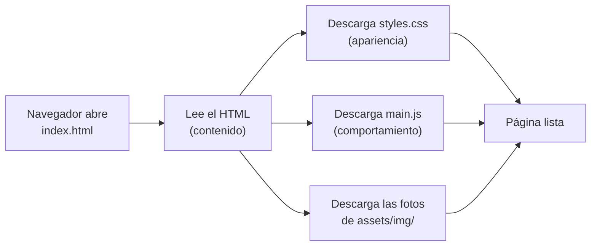

Este sitio es **estático**: no hay base de datos ni servidor que "arme" la página. Lo que escribes en los archivos es exactamente lo que ve el visitante. Para probarlo, **haz doble clic en `index.html`** y se abrirá en tu navegador.

---

## 1. Mapa de todos los archivos

```text
tallerDDD/
├── index.html                  ← la página principal
├── blog/
│   ├── citrusvision.html       ← artículo 1
│   └── olimpiada.html          ← artículo 2
├── assets/
│   ├── css/styles.css          ← todo el diseño
│   ├── js/main.js              ← menú, imprimir y año
│   └── img/                    ← fotos y favicon
├── robots.txt                  ← instrucciones para buscadores
├── sitemap.xml                 ← lista de páginas para buscadores
├── _headers                    ← reglas de seguridad para Cloudflare
├── .assetsignore               ← lo que Cloudflare NO publica
├── wrangler.jsonc              ← configuración de Cloudflare
├── .gitignore                  ← lo que Git NO guarda
├── .github/
│   └── copilot-instructions.md ← reglas Ponytail para Copilot
├── graphify-out/               ← mapa del código (Graphify)
├── AGENTS.md                   ← reglas para agentes de IA
├── README.md                   ← portada del repositorio
├── docs/                       ← esta guía y sus capturas
└── ejercicio_1/                ← análisis de carrera (Colab)
```

### Archivos del sitio (se publican)

| Archivo | Qué es | ¿Lo editas? |
| --- | --- | --- |
| `index.html` | La página principal. Tiene todas las secciones: portada, Sobre mí, Rumbo, Proyectos, Blog, CV y Contacto. Cada una empieza con un comentario `<!-- ... -->` que explica para qué sirve. | **Sí**, es donde pones tu información |
| `blog/citrusvision.html` | Artículo largo sobre el proyecto CitrusVision | Sí: sustitúyelo por un proyecto tuyo |
| `blog/olimpiada.html` | Artículo corto sobre una experiencia académica | Sí, o bórralo |
| `assets/css/styles.css` | Todo el diseño, dividido en 13 secciones numeradas | Sobre todo la **sección 1** (colores) |
| `assets/js/main.js` | 38 líneas: abre y cierra el menú en celular, activa el botón de imprimir y pone el año en el pie | Normalmente no |
| `assets/img/mateo-440.webp`, `mateo-900.webp`, `mateo-1300.webp` | La foto de la portada en 3 tamaños | Sí: pon tu foto |
| `assets/img/citrusvision-680.webp`, `-1200.webp`, `-1600.webp` | La foto del proyecto en 3 tamaños | Sí: pon la de tu proyecto |
| `assets/img/favicon.svg` | El ícono pequeño de la pestaña del navegador (un dibujo vectorial) | Opcional |
| `robots.txt` | Le dice a Google qué puede revisar y dónde está el sitemap | Solo para cambiar el dominio |
| `sitemap.xml` | Lista de todas tus páginas | Cuando agregues o quites artículos |
| `_headers` | Reglas de seguridad que Cloudflare agrega a cada página | No |

### Archivos de configuración (no se publican)

| Archivo | Qué es |
| --- | --- |
| `.assetsignore` | Lista de lo que Cloudflare **no** debe publicar: `ejercicio_1/`, `docs/`, `README.md`, archivos ocultos… Funciona como `.gitignore`. |
| `wrangler.jsonc` | Configuración de Cloudflare. Lo único que cambias es `"name"`, que debe ser igual al nombre del proyecto en Cloudflare. |
| `.gitignore` | Lista de lo que Git no sube a GitHub: archivos del sistema (`.DS_Store`), el entorno de Python `.venv/` y la caché de Graphify |
| `graphify-out/` | El mapa del código que generó Graphify: `graph.html` (interactivo), `GRAPH_REPORT.md` (resumen) y `wiki/`. Ver [sección 7.2](#72-graphify-el-mapa-de-tu-código) |
| `.github/copilot-instructions.md` | Reglas de [Ponytail](https://ponytail.dev/) para GitHub Copilot en VS Code (ver [sección 7](#7-herramientas-ponytail-y-graphify)) |
| `AGENTS.md` | Reglas para cualquier agente de IA (Claude, Codex, Copilot…): qué puede y qué no puede hacer en este proyecto |
| `README.md` | La portada del repositorio en GitHub |
| `docs/GUIA.md` y `docs/img/` | Esta guía y sus capturas |

### Ejercicio 1 (no se publica)

| Archivo | Qué es |
| --- | --- |
| `ejercicio_1/README.md` | Instrucciones del ejercicio, fuentes y límites de los datos |
| `ejercicio_1/Career_Intelligence_Sonora_2026.ipynb` | El notebook que abres en Google Colab |
| `ejercicio_1/Career_Intelligence_Sonora_2026.py` | Las mismas celdas como script de Python |
| `ejercicio_1/CSV_Career_Intelligence_Sonora_2026.zip` | Los 15 CSV comprimidos: es lo que subes a Colab |
| `ejercicio_1/datos/*.csv` | Los 15 CSV sueltos: demografía (CONAPO), economía (INEGI), salarios (OLA y BLS), vacantes de Hermosillo, municipios, rutas de formación y perfil de ejemplo |
| `ejercicio_1/MANIFIESTO.json` | Conteo de filas y descripción de cada CSV |
| `ejercicio_1/GUIA_DOCENTE_Y_ESTUDIANTE.md` | Agenda de 80 minutos y preguntas para la clase |
| `ejercicio_1/plan_carrera_mecatrónica_ejemplo.md` | Ejemplo del plan que descarga el notebook; sus 4 campos van a la sección **Rumbo** del sitio |

---

## 2. Recorrido por la página, sección por sección

Para cada sección verás: **cómo se ve**, **el HTML** que la forma, **el CSS** que la decora y **qué cambiar**.

### 2.1 La "cabeza" del HTML (`<head>`)

No se ve en la página, pero es lo primero que leen el navegador y Google:

```html
<head>
  <meta charset="utf-8">                                  <!-- acentos y ñ -->
  <meta name="viewport" content="width=device-width,initial-scale=1">  <!-- se adapta al celular -->
  <meta name="robots" content="noindex,nofollow">        <!-- Google NO la muestra (ver sección 5) -->
  <title>Mateo Duarte · Ingeniería Mecatrónica, robótica y visión artificial</title>
  <meta name="description" content="Estudiante de Ingeniería Mecatrónica en Hermosillo...">
  <link rel="stylesheet" href="assets/css/styles.css">  <!-- conecta el CSS -->
  <script defer src="assets/js/main.js"></script>       <!-- conecta el JavaScript -->
</head>
```

> **Qué cambiar:** `<title>` y `description` con tu nombre y tu carrera. Es el texto que aparece en Google y en la pestaña del navegador.

### 2.2 Portada (hero)

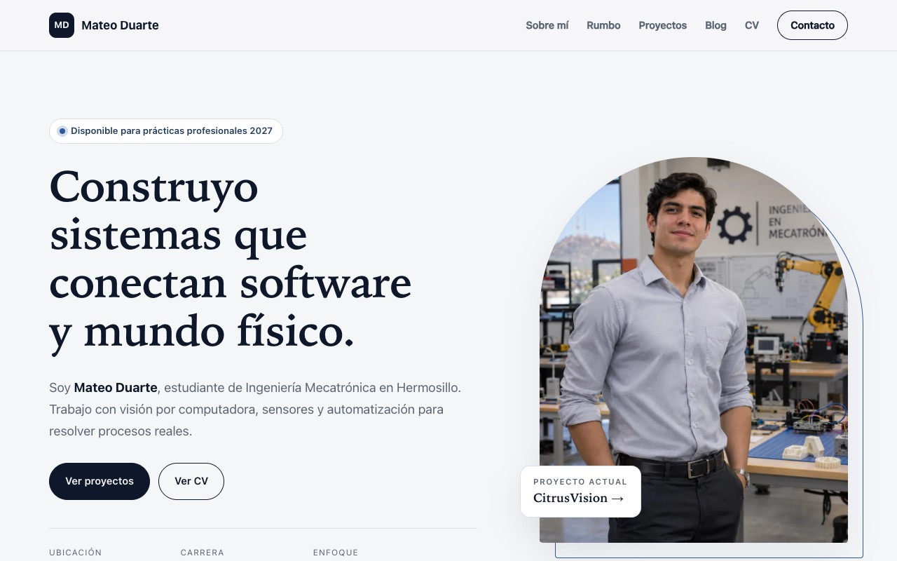

La primera pantalla: una frase que te define, quién eres, dos botones y tu foto.

```html
<section class="hero container" id="inicio">
  <div class="hero-text">
    <p class="status"><span class="dot"></span> Disponible para prácticas profesionales 2027</p>
    <h1>Construyo sistemas que conectan software y mundo físico.</h1>
    <p class="lead">Soy <strong>Mateo Duarte</strong>, estudiante de Ingeniería Mecatrónica...</p>
    <a href="#proyectos" class="btn">Ver proyectos</a>
  </div>
  <figure class="hero-figure">
    
  </figure>
</section>
```

- `class="..."` conecta el elemento con su estilo en el CSS.
- `srcset` ofrece la foto en 3 tamaños: el navegador descarga **solo el que necesita**. Un celular baja la de 440 px y una laptop, la de 900 px.
- `alt` describe la foto para personas ciegas que usan lector de pantalla. **Siempre** escríbelo.

El CSS que acomoda texto y foto en dos columnas:

```css
.hero {
  display: grid;                        /* activa la cuadrícula */
  grid-template-columns: 1.15fr .85fr;  /* columna de texto un poco más ancha que la de foto */
  align-items: center;                  /* centra verticalmente */
  gap: clamp(32px, 6vw, 88px);          /* espacio entre columnas: entre 32 y 88 px según la pantalla */
}
```

> **Qué cambiar:** la frase del `<h1>`, el párrafo `lead`, los datos rápidos (`Ubicación`, `Carrera`, `Enfoque`) y la foto.

### 2.3 Sobre mí

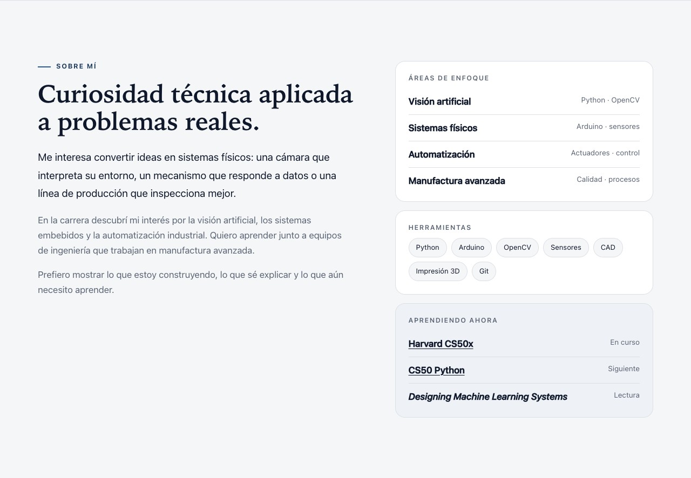

Dos columnas: a la izquierda quién eres; a la derecha tres paneles (áreas de enfoque, herramientas y qué estás aprendiendo).

```html
<div class="panel">
  <h3 class="panel-title">Herramientas</h3>
  <ul class="chips">
    <li>Python</li><li>Arduino</li><li>OpenCV</li>
  </ul>
</div>
```

Cada `<li>` dentro de `.chips` se dibuja como una "pastilla" redondeada:

```css
.chips li {
  padding: 6px 13px;
  border: 1px solid var(--line);
  border-radius: 999px;     /* un radio enorme = bordes totalmente redondos */
  background: var(--bg);
}
```

> **Qué cambiar:** tus párrafos y tus herramientas. Agrega o quita `<li>` libremente. Solo pon herramientas que de verdad sepas usar.

### 2.4 Rumbo (conecta con el Ejercicio 1)


Aquí van los **cuatro campos** que llenaste en el plan del Ejercicio 1: hipótesis, evidencia, límite y acción a 30 días.

```html
<div class="compass">
  <article class="compass-main">
    <p class="meta">Mi hipótesis</p>
    <p>Enfocar mi formación en <strong>automatización y calidad...</strong></p>
  </article>
  <article class="compass-item">
    <p class="meta">Evidencia</p>
    <p>La manufactura pesa 1.18 veces más en el empleo de Sonora que en el de México...</p>
  </article>
  <!-- "Lo que la limita" y "Próximos 30 días" siguen el mismo patrón -->
</div>
```

```css
.compass { display: grid; grid-template-columns: repeat(3, 1fr); }  /* 3 columnas iguales */
.compass-main { grid-column: 1 / -1; }  /* la hipótesis ocupa todo el ancho: de la primera a la última columna */
```

> **Qué cambiar:** copia los 4 campos de tu `plan_carrera_*.md`. Usa solo cifras que estén en tu plan, con su fuente.

### 2.5 Proyectos

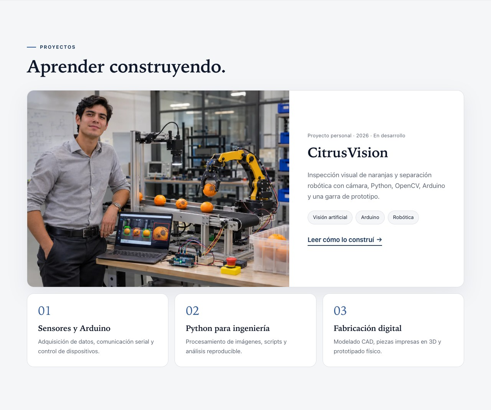

Un proyecto destacado (foto + texto + enlace a su artículo) y tres tarjetas numeradas.

```html
<article class="feature">
  
  <div class="feature-body">
    <h3>CitrusVision</h3>
    <a class="link-arrow" href="blog/citrusvision.html">Leer cómo lo construí</a>
  </div>
</article>
```

`loading="lazy"` hace que la foto se descargue solo cuando el visitante baja hasta ella, y la página carga más rápido.

> **Qué cambiar:** tu proyecto principal y tus líneas de exploración. Si aún no tienes un proyecto, describe uno en curso con su estado real.

### 2.6 Blog

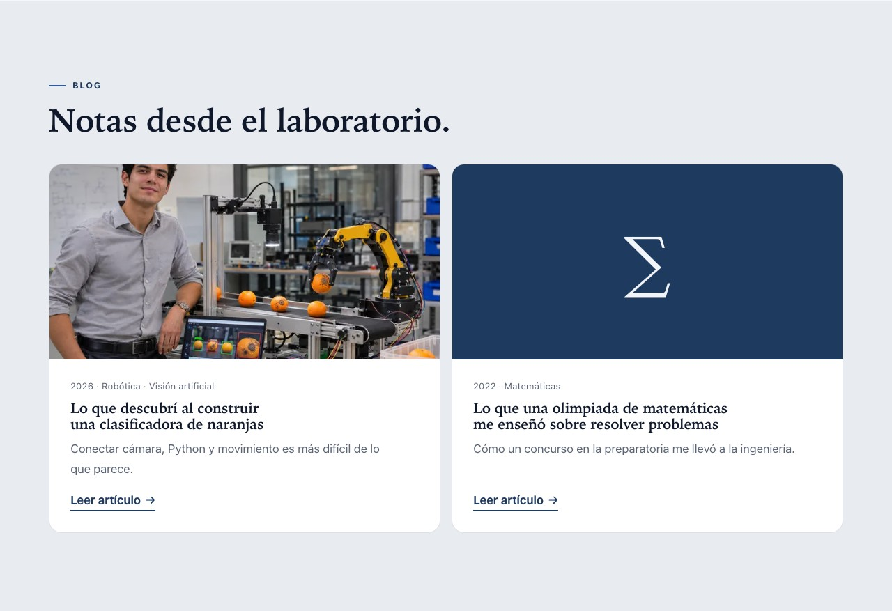

Cada tarjeta es un enlace (`<a class="post">`) a un archivo de la carpeta `blog/`. Así se ve un artículo por dentro:


Los artículos usan **la misma hoja de estilos** que la portada. Como viven dentro de `blog/`, sus rutas empiezan con `../` ("sube una carpeta"):

```html
<link rel="stylesheet" href="../assets/css/styles.css">
<a href="../index.html#blog">Volver al blog</a>
```

> **Para agregar un artículo:** copia `blog/olimpiada.html`, cambia título, descripción y texto; agrega una tarjeta en la sección Blog de `index.html` y una línea en `sitemap.xml`.

### 2.7 CV

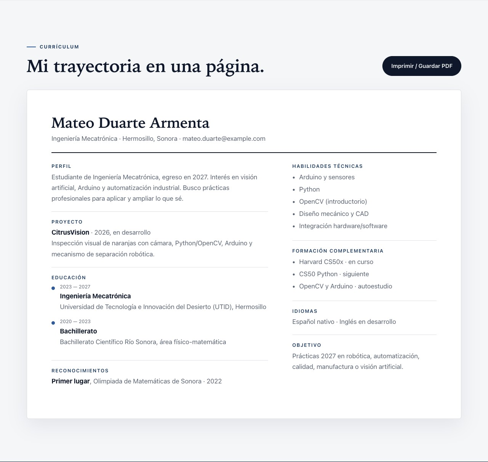

El CV se ve como una hoja de papel. El botón **Imprimir / Guardar PDF** abre el diálogo de impresión y **solo se imprime la hoja**:

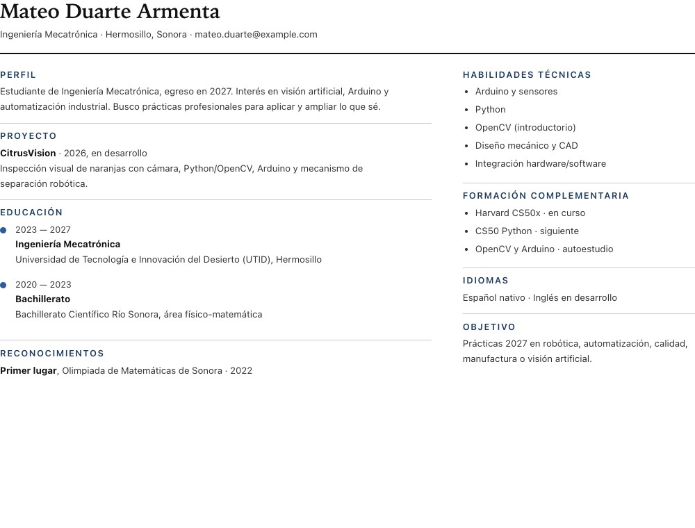

```html
<button class="btn" type="button" data-print>Imprimir / Guardar PDF</button>
<div class="cv-sheet"> ... </div>
```

El atributo `data-print` es la "etiqueta" que busca el JavaScript (ver [sección 4](#4-el-javascript-línea-por-línea)). Lo que se oculta al imprimir lo decide el CSS (ver [3.5](#35-impresión)).

> **Qué cambiar:** tu perfil, proyecto, educación, reconocimientos, habilidades e idiomas. **Solo información verificable.**

### 2.8 Contacto (pie de página)

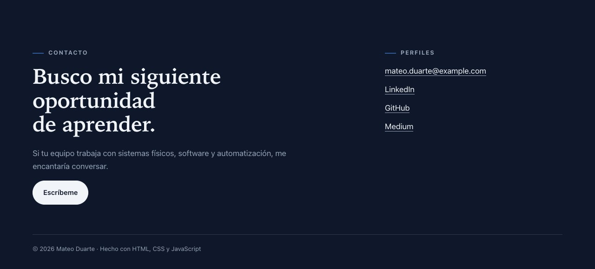

```html
<a href="mailto:mateo.duarte@example.com" class="btn btn-light">Escríbeme</a>
<li><a href="https://www.linkedin.com/" target="_blank" rel="noopener noreferrer">LinkedIn</a></li>
```

- `mailto:` abre el programa de correo del visitante.
- `target="_blank"` abre el enlace en otra pestaña; `rel="noopener noreferrer"` es una protección de seguridad para esos enlaces.

> **Qué cambiar:** tu correo y la URL de **tus** perfiles. Si no tienes un perfil, borra esa línea; no dejes enlaces genéricos.

---

## 3. El CSS a fondo

### 3.1 Cómo leer una regla CSS

```css
.btn {                 /* SELECTOR: a qué elementos se aplica (class="btn") */
  padding: 13px 22px;  /* PROPIEDAD: VALOR; → relleno interior: 13 px arriba/abajo, 22 px a los lados */
  border-radius: 999px;/* esquinas redondas */
  background: var(--ink);  /* color de fondo tomado de una variable */
}
```

`styles.css` está dividido en **13 secciones**. Busca `==` para saltar entre ellas:

| # | Sección | Qué controla |
| --- | --- | --- |
| 1 | Variables de diseño | **Todos los colores y fuentes**, claro y oscuro |
| 2 | Base | Reglas generales: tipografía, enlaces, imágenes y títulos |
| 3 | Piezas reutilizables | Contenedor, botones, chips, etiquetas y flechas |
| 4 | Encabezado y menú | Barra superior fija |
| 5 | Portada | Texto, foto en arco y tarjeta flotante |
| 6 | Secciones, Sobre mí y Rumbo | Espaciado, franjas de color, paneles |
| 7 | Proyectos | Proyecto destacado y tarjetas |
| 8 | Blog | Tarjetas de artículos |
| 9 | CV | La hoja de papel y su línea de tiempo |
| 10 | Pie de página | Contacto con fondo oscuro |
| 11 | Páginas de artículo | Estilos de `blog/*.html` |
| 12 | Responsive | Tablet y celular |
| 13 | Accesibilidad e impresión | Movimiento reducido y versión impresa del CV |

### 3.2 Variables: cambia los colores en un solo lugar

Una **variable** guarda un valor con nombre (`--ink`) para usarlo en muchos lugares con `var(--ink)`. Si cambias la variable, cambia en todo el sitio:

```css
:root {
  --bg: #f5f6f8;        /* fondo general, gris muy claro */
  --surface: #ffffff;   /* tarjetas y paneles */
  --ink: #0f172a;       /* texto principal, casi negro */
  --muted: #5b6474;     /* texto secundario, gris */
  --accent: #2f5b9a;    /* azul acero: detalles y enlaces */
  --brand: #1e3a5f;     /* azul marino: etiquetas */
  --dark: #0f172a;      /* fondo del pie de página */
}
```

> **Ejercicio:** cambia `--brand` a `#7c2d12` (terracota), guarda y recarga la página. Todas las etiquetas cambian de color.

### 3.3 Modo oscuro automático

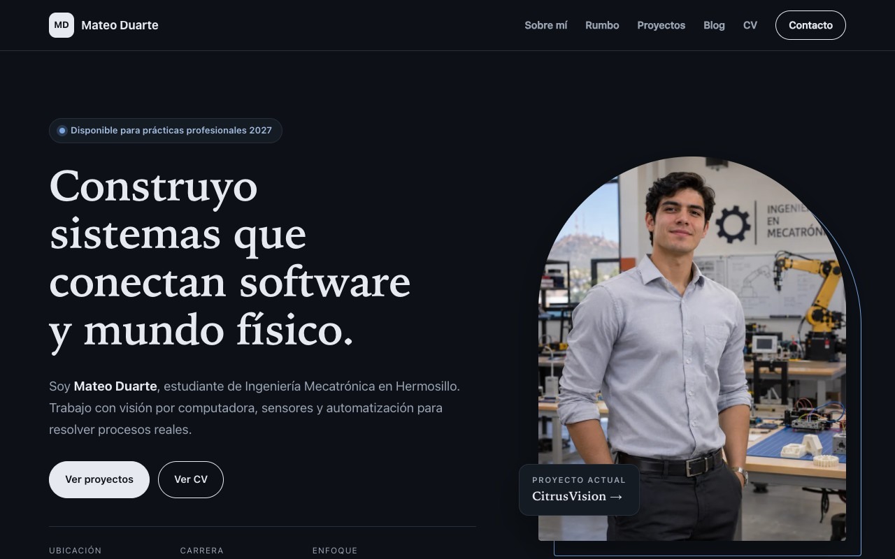

Si la computadora o el celular del visitante usa tema oscuro, el sitio cambia solo. No hay JavaScript: el CSS **pregunta** al sistema y redefine las variables:

```css
@media (prefers-color-scheme: dark) {
  :root {
    --bg: #0d1117;   /* fondo casi negro */
    --ink: #e6e9ef;  /* texto claro */
  }
}
```

### 3.4 Responsive: el mismo sitio en celular

<p>
  
  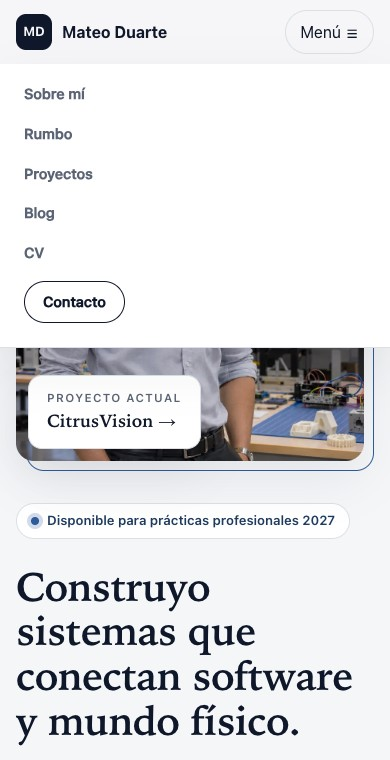
</p>

Un **media query** aplica reglas solo cuando la pantalla mide cierto ancho o menos:

```css
@media (max-width: 720px) {                 /* pantallas de 720 px o menos (celulares) */
  .hero, .split, .cards { grid-template-columns: 1fr; }  /* todo a una sola columna */
  .nav-toggle { display: block; }           /* aparece el botón "Menú ☰" */
  .nav { display: none; }                   /* el menú se esconde... */
  .nav.open { display: flex; }              /* ...hasta que JavaScript le pone la clase "open" */
}
```

### 3.5 Impresión

Cuando imprimes, el navegador aplica las reglas de `@media print`. Aquí se oculta todo menos el CV:

```css
@media print {
  .site-header, .hero, .section:not(#cv), .footer, .no-print { display: none !important; }
  .cv-sheet { padding: 0; border: 0; box-shadow: none; }  /* la "hoja" sin bordes ni sombra */
}
```

`.section:not(#cv)` significa "todas las secciones **excepto** la del CV".

### 3.6 Accesibilidad

```css
:focus-visible { outline: 3px solid var(--accent); }  /* contorno visible al navegar con Tab */

@media (prefers-reduced-motion: reduce) {             /* personas que desactivan animaciones */
  *, *::before, *::after { transition-duration: .01ms !important; }
}
```

Prueba: abre el sitio y presiona **Tab** varias veces. Primero aparece "Saltar al contenido" y luego cada enlace se marca con un contorno azul.

---

## 4. El JavaScript, línea por línea

El archivo `assets/js/main.js` completo:

```js
(() => {                                   // función que se ejecuta sola, para no ensuciar el resto del sitio
  'use strict';                            // modo estricto: el navegador avisa de errores comunes

  // 1. MENÚ EN CELULAR
  const toggle = document.querySelector('[data-menu-toggle]');  // busca el botón "Menú ☰"
  const nav = document.querySelector('[data-nav]');            // busca el menú
  if (toggle && nav) {                                          // solo si ambos existen en la página
    toggle.addEventListener('click', () => {                    // cuando hacen clic en el botón...
      const open = nav.classList.toggle('open');                // ...pone o quita la clase "open"
      toggle.setAttribute('aria-expanded', String(open));       // avisa a lectores de pantalla si está abierto
      toggle.setAttribute('aria-label', open ? 'Cerrar menú' : 'Abrir menú');
    });
    nav.querySelectorAll('a').forEach(link => link.addEventListener('click', () => {
      nav.classList.remove('open');                             // al elegir una opción, el menú se cierra
      toggle.setAttribute('aria-expanded', 'false');
      toggle.setAttribute('aria-label', 'Abrir menú');
    }));
  }

  // 2. IMPRIMIR CV
  document.querySelectorAll('[data-print]').forEach(btn => {
    btn.addEventListener('click', () => window.print());       // abre el diálogo de impresión
  });

  // 3. AÑO DEL PIE DE PÁGINA
  const year = document.querySelector('[data-year]');
  if (year) year.textContent = String(new Date().getFullYear());  // escribe el año actual
})();
```

**La idea clave:** el JavaScript no cambia colores ni tamaños. Solo **pone o quita una clase** (`open`), y el CSS decide cómo se ve esa clase. HTML, CSS y JS trabajan juntos así:

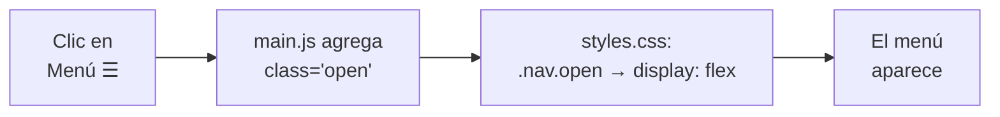

> Se carga con `defer` (`<script defer src="...">`): el navegador espera a leer todo el HTML antes de ejecutarlo, así el botón ya existe cuando el código lo busca.

---

## 5. SEO: cómo te encuentran los buscadores

| Pieza | Dónde está | Para qué |
| --- | --- | --- |
| `<title>` y `<meta name="description">` | `<head>` de cada página | El título azul y el texto gris que muestra Google |
| Open Graph (`og:title`, `og:image`…) | `<head>` de cada página | La vista previa al compartir el enlace en WhatsApp o LinkedIn |
| JSON-LD | `<head>` de `index.html` | Datos estructurados: le dicen a Google "esto es una persona, se llama así" |
| `<link rel="canonical">` | `<head>` de cada página | La dirección oficial de la página |
| `robots.txt` | Raíz | Permite a los buscadores revisar el sitio e indica dónde está el sitemap |
| `sitemap.xml` | Raíz | Lista de todas las páginas |
| `alt` en imágenes | Cada `` | Google entiende las fotos y es accesible |

### `noindex`: por qué Google no muestra este sitio

```html
<meta name="robots" content="noindex,nofollow">
```

Esta línea le pide a Google que **no** muestre la página en sus resultados. Está activa porque el sitio de ejemplo es de un personaje de demostración. **Cuando todo el contenido sea tuyo y real:**

1. Con **Buscar y reemplazar** (`Ctrl+Shift+H` o `Cmd+Shift+H`), cambia `https://example.com` por tu dirección real en todo el proyecto.
2. Borra la línea `noindex` de las 3 páginas HTML.

> Nadie puede prometerte el primer lugar en Google. El SEO técnico solo ayuda a que te encuentren por tu nombre y tu especialidad.

---

## 6. Publicar en Cloudflare

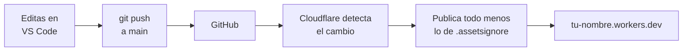

### Paso 1: crea el proyecto

En [dash.cloudflare.com](https://dash.cloudflare.com) → **Workers & Pages** → **Create** → **Import a repository** → elige tu repositorio:

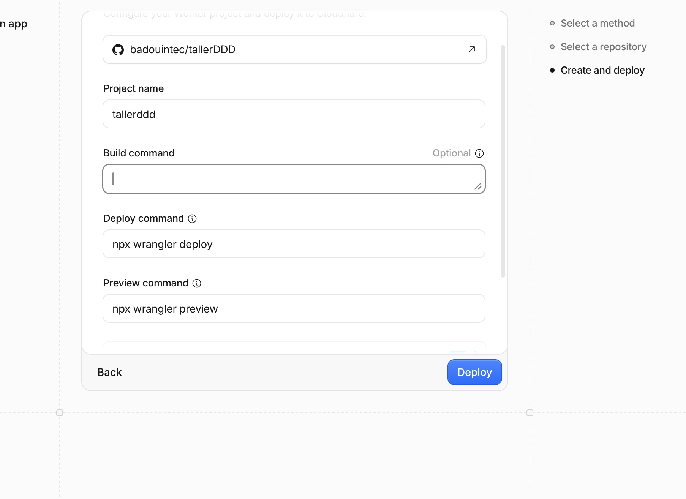

- **Project name:** el mismo que pusiste en `"name"` dentro de `wrangler.jsonc`.
- **Build command:** déjalo vacío. No hay nada que compilar.

### Paso 2: opciones de despliegue

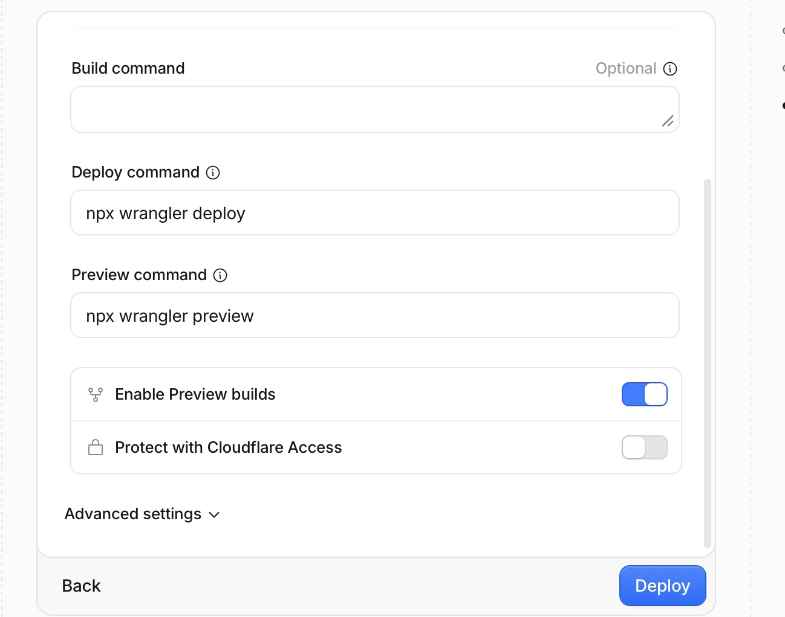

| Opción | Qué poner |
| --- | --- |
| Deploy command | Déjalo como viene: `npx wrangler deploy` |
| Preview command | Déjalo como viene |
| Enable Preview builds | **Apagado**: solo usas la rama `main` |
| Protect with Cloudflare Access | **Apagado**: si lo enciendes, piden iniciar sesión para ver tu sitio |

Dale **Deploy**. Desde ese momento, **cada `git push` a `main` publica el sitio solo**.

### Los archivos que lo hacen funcionar

`wrangler.jsonc`: le dice a Cloudflare cómo se llama el proyecto y que publique la carpeta raíz (`.`):

```jsonc
{
  "name": "tallerddd",               // ← cámbialo por el nombre de tu proyecto
  "compatibility_date": "2026-11-11",
  "assets": { "directory": "." }     // publica la raíz tal cual
}
```

`.assetsignore`: la lista de lo que **no** se publica (mismo formato que `.gitignore`):

```text
# Cualquier archivo o carpeta oculta (.git, .github, .venv...)
.*
ejercicio_1/
docs/
graphify-out/
README.md
AGENTS.md
wrangler.jsonc
```

> Si creas una carpeta con algo privado, **agrégala a `.assetsignore`** antes de hacer push.

`_headers`: reglas de seguridad que Cloudflare agrega a cada página, por ejemplo prohibir que otro sitio meta el tuyo dentro de un marco (`X-Frame-Options: DENY`).

---

## 7. Herramientas: Ponytail y Graphify

### 7.1 Ponytail: que la IA escriba menos y mejor

[](https://ponytail.dev/)

[Ponytail](https://ponytail.dev/) es un conjunto de reglas para agentes de IA. Les pide **el cambio más pequeño que funcione**: reutilizar lo que ya existe, no agregar librerías innecesarias y no inventar funciones que nadie pidió. En un taller para principiantes evita que el agente llene tu proyecto de código que no entiendes.

**Ya está instalado en este repositorio** de dos formas:

| Archivo | Lo usa |
| --- | --- |
| `AGENTS.md` (sección "Ponytail" al final) | Claude Code, Codex, Cursor y la mayoría de agentes |
| `.github/copilot-instructions.md` | GitHub Copilot en VS Code |

No tienes que hacer nada: al abrir el proyecto, el agente lee esas reglas. Si quieres instalarlo como plugin en tu agente:

```bash
# Claude Code
/plugin marketplace add DietrichGebert/ponytail
/plugin install ponytail@ponytail

# Codex
codex plugin marketplace add DietrichGebert/ponytail
codex plugin add ponytail@ponytail
```

Otras herramientas: [INSTALL.md oficial](https://github.com/DietrichGebert/ponytail/blob/main/INSTALL.md).

### 7.2 Graphify: el mapa de tu código

[](https://marketplace.visualstudio.com/items?itemName=anytechiestudio.graphify-vscode)

Graphify dibuja un **mapa** de cómo se conectan los archivos y funciones de un proyecto. Sirve para entender código ajeno antes de modificarlo.

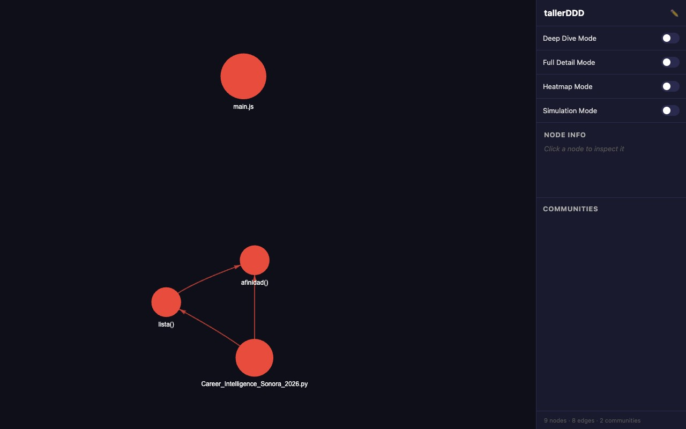

En este proyecto el mapa es pequeño: muestra `main.js` y las funciones del script del Ejercicio 1 (`lista()`, `afinidad()`). Graphify analiza **código** (JavaScript y Python); el HTML y el CSS no aparecen como nodos.

**Instalación** (requiere Python 3.9 o más reciente):

1. En VS Code, abre Extensiones (`Ctrl+Shift+X` o `Cmd+Shift+X`), busca **Graphify** (de *anytechiestudio*) e instálala.
2. En la terminal de VS Code, dentro del proyecto:

   ```bash
   python3 -m venv .venv
   ./.venv/bin/pip install anytechie-graphify
   ```

   En Windows: `py -3 -m venv .venv` y luego `.venv\Scripts\pip install anytechie-graphify`.

**Uso:**

- **Desde VS Code:** clic derecho sobre la carpeta del proyecto → **Graphify: Build Knowledge Graph**. Después: **Graphify: Open Interactive Visualizer**.
- **Desde la terminal:** `./.venv/bin/graphify update .`

El resultado se guarda en `graphify-out/`. Este repositorio ya incluye uno de ejemplo:

| Archivo | Qué es |
| --- | --- |
| `graph.html` | El mapa interactivo. Ábrelo en tu navegador (doble clic) o con **Graphify: Open Interactive Visualizer** |
| `GRAPH_REPORT.md` | Resumen en texto: nodos más conectados, grupos y huecos |
| `graph.json` | Los datos del grafo; lo usan los comandos `graphify query` y `graphify explain` |
| `wiki/` | Una ficha en Markdown por cada nodo |

`graphify-out/` se sube a GitHub como ejemplo, pero **no se publica** en el sitio (está en `.assetsignore`). Su subcarpeta `cache/` no se sube: Graphify la regenera.

Prueba hacerle preguntas al grafo desde la terminal:

```bash
./.venv/bin/graphify query "main"    # qué funciones hay en main.js y en qué línea
```

Responde algo así:

```text
NODE main.js [src=assets/js/main.js loc=L1 community=0]
NODE toggle [src=assets/js/main.js loc=L11 community=0]
NODE year [src=assets/js/main.js loc=L36 community=0]
```

> En la versión 0.4.41, los comandos `graphify explain` y `graphify path` fallan con un error del propio paquete (`UnboundLocalError`). Usa `query` o el visualizador.

> **⚠️ Dos advertencias importantes**
>
> 1. **Envía datos a un servicio externo.** Para ponerle nombre a cada grupo del mapa, Graphify manda los **nombres** de tus funciones y variables a un servicio de IA gratuito (Pollinations). No manda el código completo, pero no lo uses con proyectos privados o confidenciales.
> 2. **La IA se equivoca.** En este proyecto, Graphify describió `main.js` como *"un componente de calendario"* (lo puedes ver en `graphify-out/GRAPH_REPORT.md`). Es falso: `main.js` controla el menú, el botón de imprimir y el año del pie. **Siempre verifica** lo que te diga una IA contra el código real.
> 3. **Guarda rutas de tu computadora.** Los archivos generados incluyen rutas como `/Users/tu-usuario/...`. Antes de subir tu `graphify-out/` a un repositorio público, revísalos con **Buscar** (`Ctrl+Shift+F`) y quita tu nombre de usuario. En el de este repo ya se quitaron.

---

## 8. Problemas comunes

| Problema | Causa probable | Solución |
| --- | --- | --- |
| La página se ve sin estilos (texto plano) | La ruta al CSS está mal | Revisa `href="assets/css/styles.css"` (en `blog/` es `../assets/...`) |
| Una foto no aparece | El nombre del archivo no coincide | Revisa mayúsculas, extensión (`.webp`) y que el archivo exista en `assets/img/` |
| La foto se recorta mal (por ejemplo, se corta la cara) | El CSS recorta la foto para llenar su espacio (`object-fit: cover`) | Ajusta `object-position` en el CSS, por ejemplo `object-position: 50% 20%` para mostrar más la parte de arriba |
| El menú no abre en celular | Falta `data-menu-toggle` o `data-nav`, o falló `main.js` | Abre la consola del navegador (`F12` → Console) y busca errores rojos |
| Al imprimir sale toda la página | Quitaste la clase de una sección o del CV | Revisa `@media print` (CSS sección 13) |
| Cloudflare falla al desplegar | `"name"` en `wrangler.jsonc` es distinto del Project name | Usa exactamente el mismo nombre en ambos |
| Se publicó algo privado | No estaba en `.assetsignore` | Agrégalo, haz push y verifica abriendo esa URL (debe dar 404) |

---

## 9. Glosario

| Término | Significado |
| --- | --- |
| **Etiqueta (tag)** | Una instrucción HTML entre `< >`, como `<h1>` o `` |
| **Atributo** | Información extra de una etiqueta: `class`, `href`, `alt`, `src` |
| **Clase** | Un nombre (`class="btn"`) que conecta el HTML con una regla del CSS |
| **Selector** | La parte de una regla CSS que dice a qué elementos se aplica (`.btn`, `#cv`) |
| **Variable CSS** | Un valor con nombre (`--ink`) que se reutiliza con `var(--ink)` |
| **Media query** | Reglas CSS que se aplican solo en ciertas condiciones: celular, modo oscuro, impresión |
| **Responsive** | Que el sitio se adapta a cualquier tamaño de pantalla |
| **WebP** | Formato de imagen moderno, más ligero que JPG y PNG |
| **Sitio estático** | Sitio de archivos fijos, sin base de datos ni servidor que lo genere |
| **Repositorio** | La carpeta del proyecto con su historial en Git/GitHub |
| **Commit / push** | Guardar una versión (commit) y subirla a GitHub (push) |
| **Deploy (despliegue)** | Publicar el sitio en internet |
| **SEO** | Prácticas para que los buscadores entiendan y muestren tu sitio |
| **Agente de IA** | Un asistente que lee y modifica tu código (Claude, Copilot, Codex…) |

← [Volver al README](../README.md)
