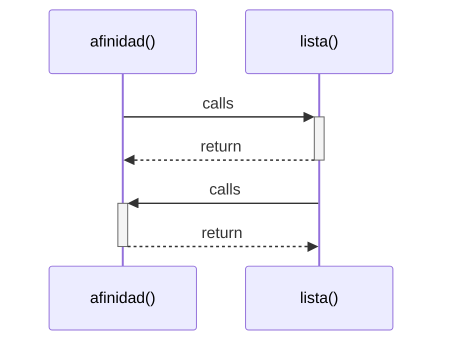

# afinidad()

> God node · 2 connections · [ejercicio_1/Career_Intelligence_Sonora_2026.py](file://ejercicio_1/Career_Intelligence_Sonora_2026.py#L206)

## Call Trace Diagram

## Connections by Relation

### calls
- [[lista()]] `EXTRACTED`

### contains
- [[Career_Intelligence_Sonora_2026.py]] `EXTRACTED`

---

*Part of the graphify knowledge wiki. See [[index]] to navigate.*