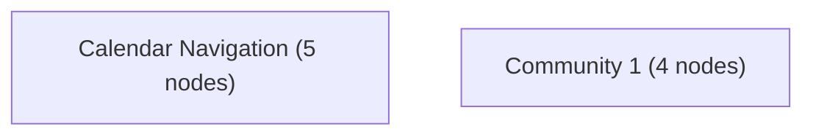

# Knowledge Graph Index

> Auto-generated by graphify. Start here — read community articles for context, then drill into god nodes for detail.

**9 nodes · 8 edges · 2 communities**

---

## System Architecture Flowchart

## Communities
(sorted by size, largest first)

- [[Calendar Navigation]] — 5 nodes
- [[Community 1]] — 4 nodes

## God Nodes
(most connected concepts — the load-bearing abstractions)

- [[lista()]] — 2 connections
- [[afinidad()]] — 2 connections
- [[toggle]] — 1 connections
- [[nav]] — 1 connections
- [[open]] — 1 connections
- [[year]] — 1 connections

---

*Generated by [graphify](https://github.com/safishamsi/graphify)*